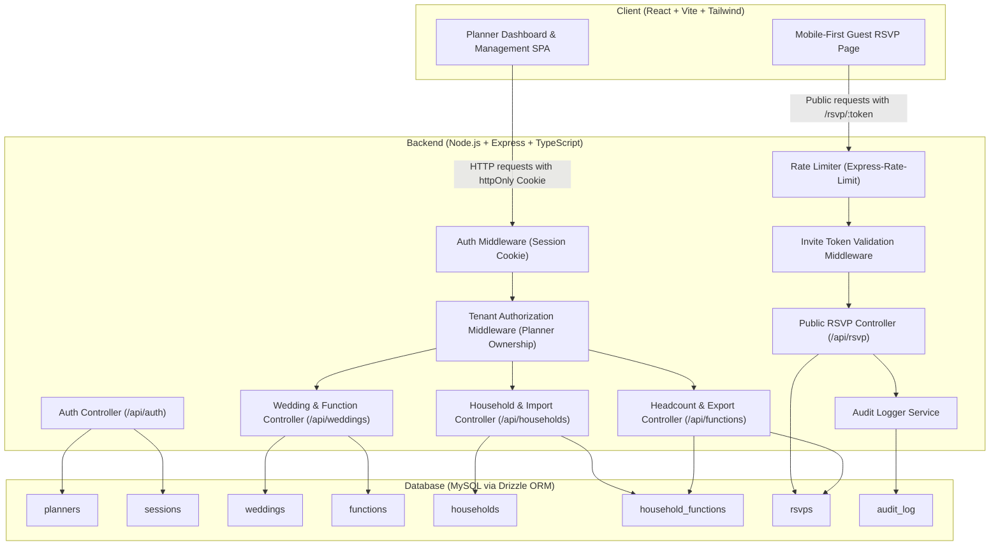

# ARCHITECTURE: Wedding RSVP & Headcount App

## 1. System Overview & Component Diagram

The application is structured as a lightweight, secure monorepo comprising a client SPA, a RESTful API backend, and a relational MySQL database.



---

## 2. Database Schema (MySQL + Drizzle ORM)

All primary keys use UUID v4 strings (`VARCHAR(36)`). Cascading foreign keys ensure that deleting a wedding or function cleans up associated records safely.

### 2.1 `planners`
Represents the authenticated event planner or couple administrator.
| Column | Type | Constraints | Description |
| :--- | :--- | :--- | :--- |
| `id` | `VARCHAR(36)` | PK | UUID v4 |
| `email` | `VARCHAR(255)` | NOT NULL, UNIQUE | Planner login email |
| `password_hash` | `VARCHAR(255)` | NOT NULL | Argon2id hash |
| `name` | `VARCHAR(100)` | NOT NULL | Full name of planner |
| `created_at` | `TIMESTAMP` | NOT NULL, DEFAULT NOW() | Registration timestamp |
| `updated_at` | `TIMESTAMP` | NOT NULL, DEFAULT NOW() ON UPDATE NOW() | Last update |

### 2.2 `sessions`
Server-side session store for authenticated planners.
| Column | Type | Constraints | Description |
| :--- | :--- | :--- | :--- |
| `id` | `VARCHAR(64)` | PK | Secure session ID |
| `planner_id` | `VARCHAR(36)` | NOT NULL, FK $\rightarrow$ `planners(id)` ON DELETE CASCADE | Associated planner |
| `expires_at` | `TIMESTAMP` | NOT NULL | Expiry time (7-day sliding window) |
| `created_at` | `TIMESTAMP` | NOT NULL, DEFAULT NOW() | Creation timestamp |

### 2.3 `weddings`
Top-level wedding project container.
| Column | Type | Constraints | Description |
| :--- | :--- | :--- | :--- |
| `id` | `VARCHAR(36)` | PK | UUID v4 |
| `planner_id` | `VARCHAR(36)` | NOT NULL, FK $\rightarrow$ `planners(id)` ON DELETE CASCADE | Owner planner |
| `title` | `VARCHAR(200)` | NOT NULL | Wedding title (e.g., "Aditi & Rahul") |
| `couple_names` | `VARCHAR(200)` | NOT NULL | Names of the couple |
| `start_date` | `DATE` | NOT NULL | Wedding starting date |
| `end_date` | `DATE` | NOT NULL | Wedding conclusion date |
| `created_at` | `TIMESTAMP` | NOT NULL, DEFAULT NOW() | Creation timestamp |
| `updated_at` | `TIMESTAMP` | NOT NULL, DEFAULT NOW() ON UPDATE NOW() | Last update |

*Index:* `INDEX idx_weddings_planner (planner_id)`

### 2.4 `functions`
Sub-events belonging to a wedding (e.g., Haldi, Mehendi, Sangeet, Wedding Ceremony, Reception).
| Column | Type | Constraints | Description |
| :--- | :--- | :--- | :--- |
| `id` | `VARCHAR(36)` | PK | UUID v4 |
| `wedding_id` | `VARCHAR(36)` | NOT NULL, FK $\rightarrow$ `weddings(id)` ON DELETE CASCADE | Parent wedding |
| `name` | `VARCHAR(100)` | NOT NULL | Function name |
| `date_time` | `DATETIME` | NOT NULL | Scheduled start date and time |
| `venue` | `VARCHAR(255)` | NOT NULL | Venue or hall location |
| `created_at` | `TIMESTAMP` | NOT NULL, DEFAULT NOW() | Creation timestamp |
| `updated_at` | `TIMESTAMP` | NOT NULL, DEFAULT NOW() ON UPDATE NOW() | Last update |

*Index:* `INDEX idx_functions_wedding (wedding_id)`

### 2.5 `households`
Guest party or family unit receiving a single collective invitation.
| Column | Type | Constraints | Description |
| :--- | :--- | :--- | :--- |
| `id` | `VARCHAR(36)` | PK | UUID v4 |
| `wedding_id` | `VARCHAR(36)` | NOT NULL, FK $\rightarrow$ `weddings(id)` ON DELETE CASCADE | Parent wedding |
| `name` | `VARCHAR(150)` | NOT NULL | Household name (e.g., "Kapoor Family") |
| `primary_contact_name`| `VARCHAR(100)` | NOT NULL | Primary contact |
| `phone` | `VARCHAR(20)` | NOT NULL | Phone number (with country code) |
| `expected_party_size` | `INT` | NOT NULL, DEFAULT 1 | Initial estimated attendance |
| `invite_token` | `VARCHAR(64)` | NOT NULL, UNIQUE | 128-bit unguessable random hex token |
| `notes` | `TEXT` | NULL | Planner internal notes |
| `created_at` | `TIMESTAMP` | NOT NULL, DEFAULT NOW() | Creation timestamp |
| `updated_at` | `TIMESTAMP` | NOT NULL, DEFAULT NOW() ON UPDATE NOW() | Last update |

*Indexes:*
- `UNIQUE INDEX uq_households_token (invite_token)`
- `INDEX idx_households_wedding_phone (wedding_id, phone)`

### 2.6 `household_functions` (Invitation Join Table)
Explicitly records which households are invited to which specific functions.
| Column | Type | Constraints | Description |
| :--- | :--- | :--- | :--- |
| `id` | `VARCHAR(36)` | PK | UUID v4 |
| `household_id` | `VARCHAR(36)` | NOT NULL, FK $\rightarrow$ `households(id)` ON DELETE CASCADE | Invited household |
| `function_id` | `VARCHAR(36)` | NOT NULL, FK $\rightarrow$ `functions(id)` ON DELETE CASCADE | Target function |
| `created_at` | `TIMESTAMP` | NOT NULL, DEFAULT NOW() | Invitation assignment date |

*Constraints:*
- `UNIQUE INDEX uq_household_function (household_id, function_id)`
- `INDEX idx_hf_function (function_id)`

### 2.7 `rsvps`
Guest RSVP responses per function and household.
| Column | Type | Constraints | Description |
| :--- | :--- | :--- | :--- |
| `id` | `VARCHAR(36)` | PK | UUID v4 |
| `function_id` | `VARCHAR(36)` | NOT NULL, FK $\rightarrow$ `functions(id)` ON DELETE CASCADE | Function answered |
| `household_id` | `VARCHAR(36)` | NOT NULL, FK $\rightarrow$ `households(id)` ON DELETE CASCADE | Responding household |
| `status` | `ENUM('yes', 'no', 'maybe')`| NOT NULL | Attendance status |
| `party_size` | `INT` | NOT NULL, DEFAULT 0 | Confirmed headcount |
| `veg_count` | `INT` | NOT NULL, DEFAULT 0 | Vegetarian count |
| `nonveg_count`| `INT` | NOT NULL, DEFAULT 0 | Non-vegetarian count |
| `checked_in` | `BOOLEAN` | NOT NULL, DEFAULT FALSE | On-site arrival check-in |
| `actual_party_size` | `INT` | NULL | Actual count verified at door |
| `dietary_notes` | `TEXT` | NULL | Allergies or specific notes |
| `responded_at`| `TIMESTAMP` | NOT NULL, DEFAULT NOW() ON UPDATE NOW() | Timestamp of last response |

*Constraints:*
- `UNIQUE INDEX uq_rsvp_func_hh (function_id, household_id)`
- Invariant: When `status = 'yes'`, `veg_count + nonveg_count == party_size` and `party_size >= 1`.
- When `status = 'no'`, `party_size = 0`, `veg_count = 0`, `nonveg_count = 0`.

### 2.8 `audit_log`
Tracks changes to sensitive invitation and RSVP data for accountability.
| Column | Type | Constraints | Description |
| :--- | :--- | :--- | :--- |
| `id` | `VARCHAR(36)` | PK | UUID v4 |
| `wedding_id` | `VARCHAR(36)` | NOT NULL, FK $\rightarrow$ `weddings(id)` ON DELETE CASCADE | Related wedding |
| `actor_type` | `ENUM('planner', 'guest', 'system')` | NOT NULL | Originator of modification |
| `actor_id` | `VARCHAR(36)` | NULL | `planner_id` or `household_id` |
| `action` | `VARCHAR(100)` | NOT NULL | Action name (e.g., `RSVP_UPDATED`) |
| `entity_type` | `VARCHAR(50)` | NOT NULL | Entity (e.g., `rsvp`, `household`) |
| `entity_id` | `VARCHAR(36)` | NOT NULL | Target entity ID |
| `old_values` | `JSON` | NULL | Prior snapshot |
| `new_values` | `JSON` | NULL | Updated snapshot |
| `ip_address` | `VARCHAR(45)` | NULL | Request IP |
| `created_at` | `TIMESTAMP` | NOT NULL, DEFAULT NOW() | Timestamp |

*Index:* `INDEX idx_audit_wedding_created (wedding_id, created_at)`

---

## 3. API Specification & Authorization Model

### 3.1 Authorization Strategy
1. **Planner Routes**: Require a valid `sessionId` cookie. Authenticated session attaches `planner_id` to `req.user`. Every route interacting with a wedding verifies that `wedding.planner_id === req.user.id`. If non-matching or non-existent, responds with `404 Not Found` (to avoid ID enumeration).
2. **Public RSVP Routes**: Do NOT use sequential database IDs. Require an unguessable 128-bit `invite_token` in the URL path (`/api/rsvp/:token`). Scoped exclusively to the single household matching that token.

---

### 3.2 Endpoint Catalog

#### Auth Endpoints
| Method | Endpoint | Auth | Request Body | Success Response | Error Cases |
| :--- | :--- | :--- | :--- | :--- | :--- |
| `POST` | `/api/auth/register` | Public (Rate Limited) | `{ email, password, name }` | `201 { id, email, name }` + Cookie | `400` validation fail, `409` email in use |
| `POST` | `/api/auth/login` | Public (Rate Limited) | `{ email, password }` | `200 { id, email, name }` + Cookie | `401` invalid credentials |
| `POST` | `/api/auth/logout` | Planner Session | None | `200 { success: true }` | `401` unauthorized |
| `GET` | `/api/auth/me` | Planner Session | None | `200 { id, email, name }` | `401` unauthorized |

#### Wedding Endpoints
| Method | Endpoint | Auth Check | Request Body | Success Response | Error Cases |
| :--- | :--- | :--- | :--- | :--- | :--- |
| `GET` | `/api/weddings` | `planner_id = session.planner_id` | None | `200 [ { id, title, couple_names, ... } ]` | `401` |
| `POST` | `/api/weddings` | Planner Session | `{ title, couple_names, start_date, end_date }` | `201 { id, ... }` | `400` validation error |
| `GET` | `/api/weddings/:id` | Ownership verify | None | `200 { id, title, ... }` | `404` not found / forbidden |
| `PUT` | `/api/weddings/:id` | Ownership verify | `{ title, couple_names, start_date, end_date }` | `200 { id, ... }` | `400`, `404` |
| `DELETE` | `/api/weddings/:id` | Ownership verify | None | `200 { deleted: true }` | `404` |

#### Function Endpoints
| Method | Endpoint | Auth Check | Request Body | Success Response | Error Cases |
| :--- | :--- | :--- | :--- | :--- | :--- |
| `GET` | `/api/weddings/:id/functions` | Wedding ownership | None | `200 [ { id, name, date_time, venue } ]` | `404` |
| `POST` | `/api/weddings/:id/functions` | Wedding ownership | `{ name, date_time, venue }` | `201 { id, ... }` | `400`, `404` |
| `PUT` | `/api/functions/:id` | Function $\rightarrow$ Wedding ownership | `{ name, date_time, venue }` | `200 { id, ... }` | `400`, `404` |
| `DELETE` | `/api/functions/:id` | Function $\rightarrow$ Wedding ownership | None | `200 { deleted: true }` | `404` |

#### Household & Invitation Endpoints
| Method | Endpoint | Auth Check | Request Body | Success Response | Error Cases |
| :--- | :--- | :--- | :--- | :--- | :--- |
| `GET` | `/api/weddings/:id/households` | Wedding ownership | None | `200 [ { id, name, primary_contact_name, phone, expected_party_size, invite_token, ... } ]` | `404` |
| `POST` | `/api/weddings/:id/households` | Wedding ownership | `{ name, primary_contact_name, phone, expected_party_size, notes }` | `201 { id, invite_token, ... }` | `400`, `404` |
| `POST` | `/api/weddings/:id/households/import-csv` | Wedding ownership | Multipart Form: `file` ($\le 2\text{MB}$) | `200 { imported: N, duplicates: [ ... ] }` | `400` invalid CSV / exceeds limit |
| `PUT` | `/api/households/:id` | Household $\rightarrow$ Wedding ownership | `{ name, primary_contact_name, phone, expected_party_size, notes }` | `200 { id, ... }` | `400`, `404` |
| `DELETE` | `/api/households/:id` | Household $\rightarrow$ Wedding ownership | None | `200 { deleted: true }` | `404` |
| `GET` | `/api/functions/:id/invitations` | Function $\rightarrow$ Wedding ownership | None | `200 [ { household_id, invited: boolean } ]` | `404` |
| `POST` | `/api/functions/:id/invitations` | Function $\rightarrow$ Wedding ownership | `{ household_ids: string[] }` | `200 { updated: N }` | `400`, `404` |

#### Headcount, Export & Check-In Endpoints
| Method | Endpoint | Auth Check | Request Body | Success Response | Error Cases |
| :--- | :--- | :--- | :--- | :--- | :--- |
| `GET` | `/api/functions/:id/headcount` | Function $\rightarrow$ Wedding ownership | Query: `?maybePct=50&staleDays=14` | `200 { invited_count, confirmed_headcount, declined_count, maybe_count, no_response_count, veg_count, nonveg_count, planning_estimate, stale_count, formula }` | `404` |
| `GET` | `/api/functions/:id/export-csv` | Function $\rightarrow$ Wedding ownership | None | `200 text/csv` (Content-Disposition: attachment) | `404` |
| `GET` | `/api/functions/:id/checkin` | Function $\rightarrow$ Wedding ownership | None | `200 [ { household_id, household_name, party_size, checked_in, actual_party_size } ]` | `404` |
| `POST` | `/api/functions/:id/checkin/:householdId` | Function $\rightarrow$ Wedding ownership | `{ checked_in: boolean, actual_party_size?: number }` | `200 { success: true }` | `400`, `404` |

#### Public Guest RSVP Endpoints
| Method | Endpoint | Auth Check | Request Body | Success Response | Error Cases |
| :--- | :--- | :--- | :--- | :--- | :--- |
| `GET` | `/api/rsvp/:token` | Token Scoped (Rate Limited) | None | `200 { household: { name, primary_contact_name }, functions: [ { id, name, date_time, venue, rsvp: { status, party_size, veg_count, nonveg_count, dietary_notes } } ] }` | `404` invalid token |
| `POST` | `/api/rsvp/:token` | Token Scoped (Rate Limited) | `{ rsvps: [ { function_id, status, party_size, veg_count, nonveg_count, dietary_notes } ] }` | `200 { success: true, updated_at }` | `400` dietary sum mismatch / invalid status, `404` token or function invalid |

---

## 4. Attendance & Headcount Business Rules (Exact Formulas)

Per Section 6 of `PROJECT_CONTEXT.md`, headcount formulas must adhere to mathematical precision:

1. **Invited Count ($I_F$)**:
   $$I_F = \text{COUNT}(\text{household\_functions WHERE function\_id} = F)$$

2. **Confirmed Headcount ($C_F$)**:
   $$C_F = \sum_{\substack{\text{status} = \text{'yes'} \\ \text{function\_id} = F}} \text{party\_size}$$

3. **Declined Count ($D_F$)**:
   $$D_F = \text{COUNT}(\text{rsvps WHERE function\_id} = F \text{ AND status} = \text{'no'})$$

4. **Maybe Count ($M_F$)**:
   $$M_F = \text{COUNT}(\text{rsvps WHERE function\_id} = F \text{ AND status} = \text{'maybe'})$$

5. **No Response Count ($NR_F$)**:
   $$NR_F = I_F - (C_F^{\text{households}} + D_F + M_F)$$
   *(Never add "Maybe" or "No response" into Confirmed Headcount).*

6. **Dietary Totals (Confirmed Only)**:
   $$\text{Veg Total} = \sum_{\substack{\text{status} = \text{'yes'} \\ \text{function\_id} = F}} \text{veg\_count}$$
   $$\text{Non-Veg Total} = \sum_{\substack{\text{status} = \text{'yes'} \\ \text{function\_id} = F}} \text{nonveg\_count}$$
   *Rule:* Enforce $\text{veg\_count} + \text{nonveg\_count} = \text{party\_size}$ on each 'yes' RSVP row.

7. **Planning Estimate ($E_F$)**:
   $$E_F = C_F + \left\lfloor \frac{P}{100} \times \left( \sum_{\substack{\text{status} = \text{'maybe'} \\ \text{function\_id} = F}} \max(\text{party\_size}, 1) \right) \right\rfloor$$
   - Default $P = 50\%$.
   - Planner can adjust $P \in [0, 100]\%$.
   - The UI strictly displays the formula: `"Planning Estimate = Confirmed (X) + P% of Maybe (Y) = Z"`.

8. **Stale RSVP Flag**:
   $$\text{is\_stale} = (\text{status} \in \{\text{'yes'}, \text{'maybe'}\}) \land (\text{responded\_at} < \text{NOW}() - N \text{ days})$$
   - Default $N = 14$ days.

---

## 5. Input Validation Rules

| Entity / Field | Rule | Validation Bounds | Failure Response |
| :--- | :--- | :--- | :--- |
| `email` | Standard RFC 5322 email | Max 255 chars | `400 "Invalid email address format"` |
| `password` | Min 8 chars, Max 128 chars | String | `400 "Password must be at least 8 characters"` |
| `wedding.title` | Alphanumeric & punctuation | 1 - 200 chars | `400 "Title is required (max 200 chars)"` |
| `function.name` | Text string | 1 - 100 chars | `400 "Function name required (max 100 chars)"` |
| `household.phone` | E.164 phone regex (`^\+?[0-9]{7,15}$`) | 7 - 15 digits | `400 "Invalid phone number format"` |
| `party_size` | Non-negative integer | $0 \le \text{size} \le 50$ | `400 "Party size must be between 0 and 50"` |
| `veg_count` / `nonveg_count` | Non-negative integer | Sum must equal `party_size` when status is `yes` | `400 "Veg and Non-Veg counts must equal total party size"` |
| `CSV Upload File` | MIME `text/csv`, size limit | Max 2MB | `400 "File exceeds 2MB limit or is not CSV"` |
| `CSV Cell Values` | Export sanitization | If starts with `=`, `+`, `-`, `@`, prepend `'` | Prevents formula execution in Excel/Sheets |

---

## 6. Monorepo Directory Structure

```
project/
├── client/                     # Vite + React + TypeScript + Tailwind
│   ├── src/
│   │   ├── api/                # Typed fetch client (auth, weddings, rsvp)
│   │   ├── components/         # Reusable UI (Button, Modal, StatCard, Badge)
│   │   ├── context/            # AuthContext, WeddingContext
│   │   ├── pages/
│   │   │   ├── auth/           # Login, Register
│   │   │   ├── dashboard/      # Function Headcount & Planning Estimate
│   │   │   ├── weddings/       # Wedding & Function Setup
│   │   │   ├── guests/         # Household List, CSV Import, Invites
│   │   │   ├── checkin/        # Mobile Check-in Screen
│   │   │   └── rsvp/           # Public Mobile Guest RSVP Screen
│   │   ├── types/              # Frontend TypeScript interfaces
│   │   ├── App.tsx
│   │   └── main.tsx
│   ├── index.html
│   ├── tailwind.config.js
│   ├── vite.config.ts
│   └── package.json
│
├── server/                     # Node.js + Express + TypeScript
│   ├── src/
│   │   ├── config/             # Environment, DB connection
│   │   ├── db/
│   │   │   ├── schema.ts       # Drizzle ORM schema definitions
│   │   │   └── migrations/     # Generated SQL migration files
│   │   ├── middleware/
│   │   │   ├── auth.ts         # Session verification
│   │   │   ├── tenant.ts       # Planner wedding ownership guard
│   │   │   ├── rateLimit.ts    # Rate limiting for auth & public RSVP
│   │   │   └── validate.ts     # Zod / standard schema validation
│   │   ├── routes/
│   │   │   ├── auth.ts
│   │   │   ├── weddings.ts
│   │   │   ├── functions.ts
│   │   │   ├── households.ts
│   │   │   └── rsvp.ts
│   │   ├── services/
│   │   │   ├── headcount.ts    # Headcount calculation engine
│   │   │   ├── csv.ts          # CSV import parsing & sanitized export
│   │   │   └── audit.ts        # Audit logger service
│   │   ├── app.ts              # Express application setup
│   │   └── index.ts            # Server entry point
│   ├── tsconfig.json
│   └── package.json
│
├── docs/                       # Architecture, scope, audits
│   ├── SCOPE.md
│   ├── ARCHITECTURE.md
│   └── AUDIT.md
│
├── PROJECT_CONTEXT.md          # Primary source of truth
├── package.json                # Root workspaces configuration
└── .env.example                # Sample environment variables
```

---

## 7. Threat Model & Security Mitigations

### 7.1 Threat: Guessing an Invite Token
- **Attack Vector**: Attacker scans or brute-forces `/rsvp/:token` URLs to view guest details or tamper with RSVPs.
- **Mitigation**:
  1. Tokens are generated using `crypto.randomBytes(16).toString('hex')` (128 bits of cryptographic entropy = $3.4 \times 10^{38}$ possibilities).
  2. Public RSVP routes are rate-limited via `express-rate-limit` to 30 requests per minute per IP.
  3. No sequential numeric IDs are accepted on public endpoints.

### 7.2 Threat: Cross-Tenant Data Access (Broken Object Level Authorization)
- **Attack Vector**: Authenticated Planner A requests `/api/weddings/:id` or `/api/functions/:id` using Planner B's UUID.
- **Mitigation**:
  1. Mandatory `requireWeddingOwner` middleware queries the database to confirm `wedding.planner_id === req.user.id`.
  2. Nested routes join against `weddings` to confirm ownership before executing reads, updates, or deletes.
  3. Unmatched ownership returns `404 Not Found` to prevent confirming the existence of other planners' UUIDs.

### 7.3 Threat: Guest Submitting Malicious / Corrupted Data
- **Attack Vector**: Guest sends negative party size, strings instead of numbers, or a 10MB payload to exhaust server memory.
- **Mitigation**:
  1. Strict server-side schema validation on `POST /api/rsvp/:token`.
  2. Invariant verification: `party_size >= 0`, `veg_count + nonveg_count == party_size`.
  3. Body parser size capped at 100KB for standard JSON endpoints.

### 7.4 Threat: CSV Import Abuse & Formula Injection
- **Attack Vector**: Planner imports a malicious CSV containing spreadsheet formulas (`=cmd|' /C ...'!A1`) or an oversized 50MB file.
- **Mitigation**:
  1. File upload size limit enforced at 2MB.
  2. CSV Export sanitizer inspects every cell string: if the string begins with `=`, `+`, `-`, or `@`, a single quote (`'`) is prepended to neutralize formula execution in Microsoft Excel and Google Sheets.

### 7.5 Threat: Login Brute-Force & Credential Stuffing
- **Attack Vector**: Attacker attempts credential dictionary attacks against `/api/auth/login`.
- **Mitigation**:
  1. Rate limiting on `/api/auth/login` (5 attempts per minute per IP).
  2. Password hashing with Argon2id introduces intentional computational cost.
  3. Constant-time comparison ensures no timing attacks reveal email validity.

### 7.6 Privacy & Regulatory (DPDP Act Awareness)
- Collect only minimal required guest data (primary name, phone, dietary preference).
- Hard deletion: Deleting a wedding deletes all related functions, guests, and RSVPs via cascading foreign keys.
- Tokens and phone numbers are never logged in backend application logs.

---

## 8. Decision Log

### Decision 1: Invite Token Storage (Plaintext vs. Hash)
- **Context**: Invite tokens act as capability URLs allowing guests to view and answer RSVPs.
- **Options**:
  - *Option A*: Store SHA-256 hash in DB; planner generates and views the link only once.
  - *Option B*: Store the 128-bit random token directly in the `households` table.
- **Choice**: **Option B**.
- **Tradeoff**: Option B allows the planner to re-copy and re-share the link anytime without re-generating it. The tradeoff is that a database leak exposes active invite links. This is an explicit, accepted tradeoff for the MVP portfolio phase documented in `PROJECT_CONTEXT.md` Section 8. (To be evaluated for hashed tokens in Phase 2).

### Decision 2: Monorepo Architecture
- **Context**: Need a cohesive repository for one developer working 10 hours/week.
- **Options**:
  - *Option A*: Two separate repositories (`wedding-client`, `wedding-api`).
  - *Option B*: Single npm workspace monorepo (`client/`, `server/`).
- **Choice**: **Option B**.
- **Tradeoff**: Single build and testing pipeline, unified type sharing between frontend and backend, and simpler deployment configuration with zero multi-repo overhead.

### Decision 3: Custom Argon2 + Session Cookies vs. Third-Party Auth (Auth0 / Firebase)
- **Context**: Planner login requirement for a portfolio project demonstrating core engineering skills.
- **Options**:
  - *Option A*: Use third-party auth service (Clerk / Auth0 / Supabase).
  - *Option B*: Native Node.js auth using Argon2 hashing + httpOnly session cookies stored in MySQL.
- **Choice**: **Option B**.
- **Tradeoff**: Eliminates external dependencies, avoids third-party rate limits/costs, demonstrates fundamental security capabilities to recruiters, and keeps the entire auth flow locally testable.

### Decision 4: Household Aggregate Dietary Counts vs. Per-Guest Name Registry
- **Context**: Catering requires exact veg vs. non-veg totals per function.
- **Options**:
  - *Option A*: Force guests to input each individual attendee's name and specific meal choice.
  - *Option B*: Capture aggregate `veg_count` and `nonveg_count` for the household where `veg + nonveg == party_size`.
- **Choice**: **Option B**.
- **Tradeoff**: Dramatically lowers RSVP friction for guests on mobile phones, directly matches Indian wedding RSVP realities, and prevents data bloat for the MVP while providing 100% of the numbers needed by caterers.
